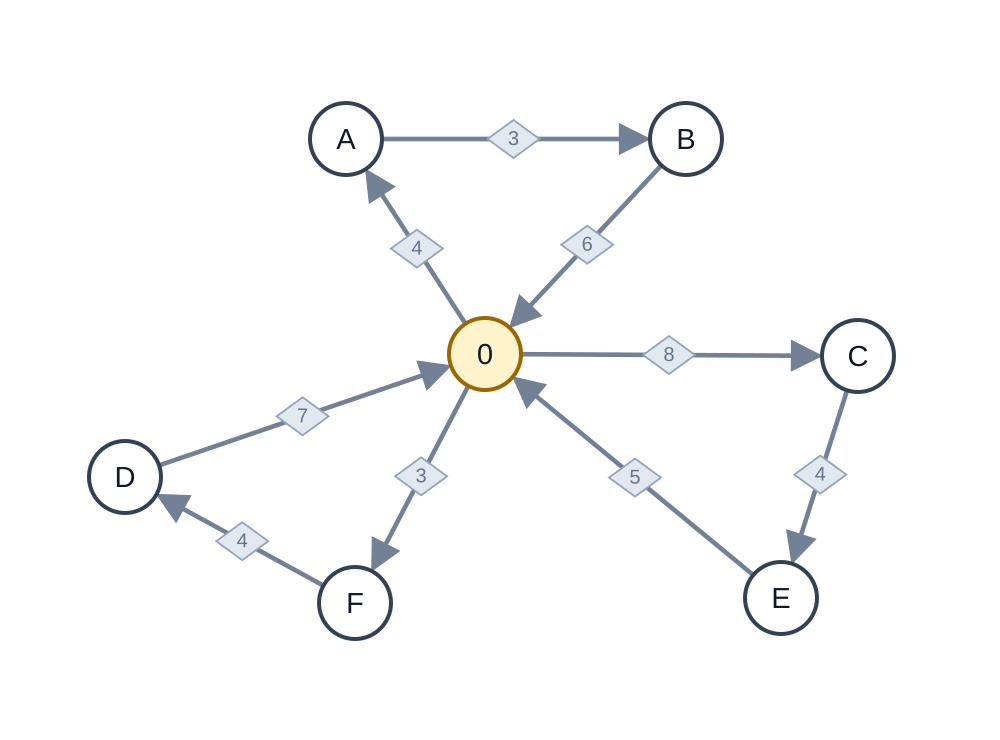
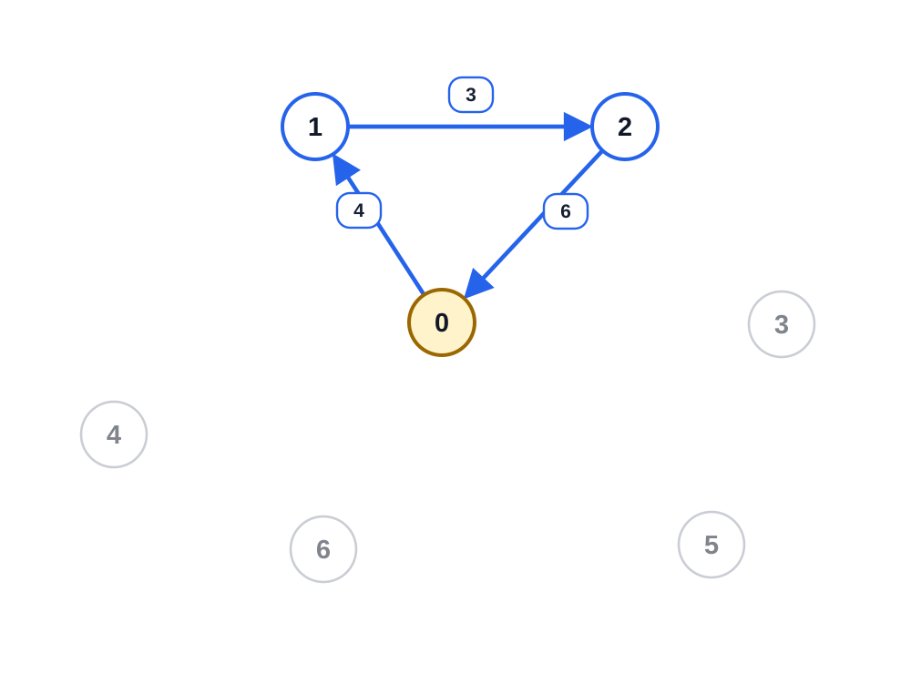
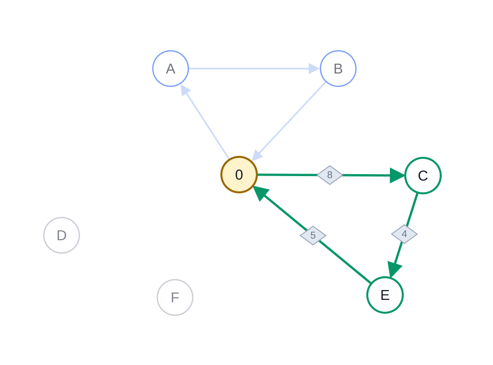
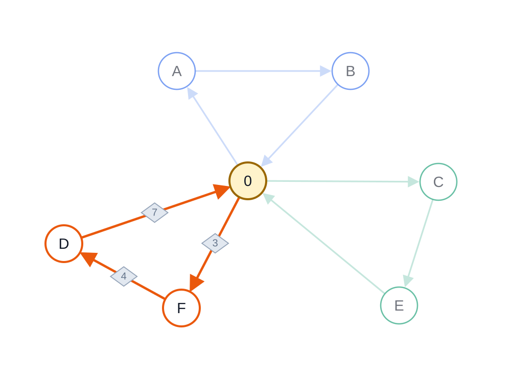
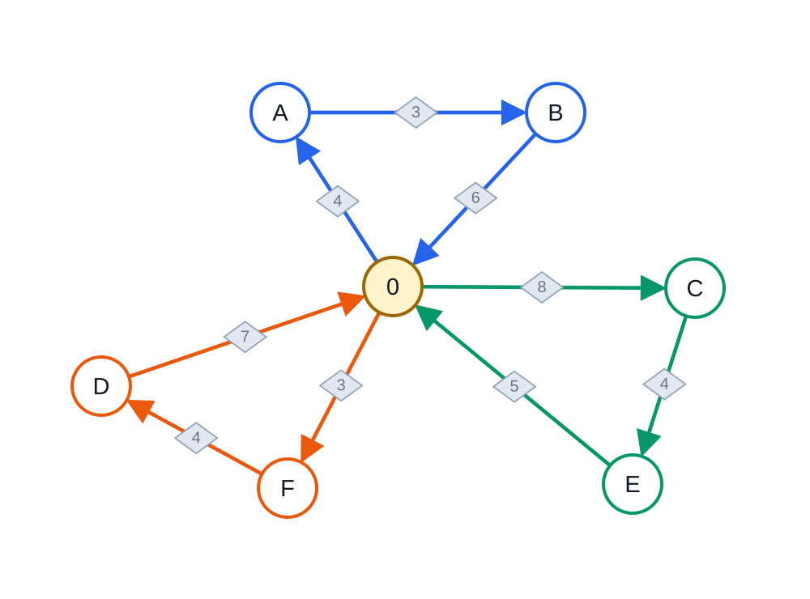

# Análise gráfica — CVRP determinístico

Esta análise complementa a [Parte A — modelo MILP](./modelagem.md), a [Parte B — Programação Dinâmica](./formulacao.md) e a [Parte C — limite de distância](./extensao.md). O objetivo é mostrar **a instância, o teste de mesa e a visualização gradual das rotas**. O exemplo é determinístico e **ilustra uma solução viável, não uma solução ótima comprovada**.

## 1. Grafo dirigido do problema



**Figura 1 — Grafo ilustrativo.** O vértice 0 representa o depósito; os vértices 1 a 6 representam clientes. As setas mostram o sentido de deslocamento, e os números em destaque são as distâncias dos arcos. O SVG possui fundo transparente; os pesos e vértices usam superfícies claras para legibilidade.

### Legenda e definições

- **Vértices:** números dentro dos círculos. O círculo dourado é o depósito; os demais são clientes.
- **Arcos:** setas que indicam deslocamentos dirigidos. O valor destacado junto a cada seta é o custo/distância daquele arco.
- **Topologia:** a disposição do desenho é didática. A posição dos vértices não define a distância entre eles.

**Conjunto de clientes:**

```math
C=\{1,2,3,4,5,6\}
```

**Vértices e arcos dirigidos do modelo geral:**

```math
V=\{0\}\cup C
```


```math
A=\{(i,j)\in V\times V:i\ne j\}
```

**Distâncias não negativas:**

```math
c_{ij}\ge0
```

**Observação:** apenas os nove arcos utilizados no teste de mesa são desenhados. O MILP e a PD descritos nas Partes A e B admitem todos os arcos entre vértices distintos; a instância completa precisará informar as demais distâncias. Por isso, ainda não podemos demonstrar que a solução ilustrada é ótima.

### Parâmetros do exemplo

| Parâmetro | Valor | Significado |
|---|---:|---|
| Q | 7 | Capacidade máxima de cada veículo |
| K | 3 | Número máximo de veículos (uma rota por veículo) |
| L | 18 | Distância máxima por rota completa |

**Demandas dos clientes:**

| Cliente | 1 | 2 | 3 | 4 | 5 | 6 |
|---|---:|---:|---:|---:|---:|---:|
| Demanda | 2 | 4 | 3 | 4 | 2 | 3 |

**Pesos dos arcos utilizados nas figuras:**

| Rota | Arcos e respectivas distâncias |
|---|---|
| Azul | 0 → 1: **4**; 1 → 2: **3**; 2 → 0: **6** |
| Verde | 0 → 3: **8**; 3 → 5: **4**; 5 → 0: **5** |
| Laranja | 0 → 6: **3**; 6 → 4: **4**; 4 → 0: **7** |

## 2. Teste de mesa — construção de uma solução candidata

Escolhemos três conjuntos disjuntos de clientes para construir rotas candidatas, uma para cada veículo. Isso demonstra **como verificar uma resposta**; não simula todas as escolhas examinadas pela otimização exata.

**Partição candidata dos clientes:**

```math
T_1=\{1,2\},\quad T_2=\{3,5\},\quad T_3=\{6,4\}
```

Em cada linha do teste de mesa, acrescentamos a distância do próximo arco e a demanda do cliente de destino, quando esse destino não é o depósito. A coluna *demanda atendida na rota* soma as demandas dos clientes já visitados naquela rota; ela **não** representa a carga física restante no veículo. No retorno ao depósito, a demanda acumulada atendida permanece igual ao total da rota.

| Rota | Etapa | Arco | Distância do arco | Demanda entregue | Demanda atendida na rota | Distância acumulada |
|---|---:|---|---:|---:|---:|---:|
| 1 — azul | 1 | 0 → 1 | 4 | 2 | 2 | 4 |
| 1 — azul | 2 | 1 → 2 | 3 | 4 | 6 | 7 |
| 1 — azul | 3 | 2 → 0 | 6 | 0 | **6** | **13** |
| 2 — verde | 1 | 0 → 3 | 8 | 3 | 3 | 8 |
| 2 — verde | 2 | 3 → 5 | 4 | 2 | 5 | 12 |
| 2 — verde | 3 | 5 → 0 | 5 | 0 | **5** | **17** |
| 3 — laranja | 1 | 0 → 6 | 3 | 3 | 3 | 3 |
| 3 — laranja | 2 | 6 → 4 | 4 | 4 | 7 | 7 |
| 3 — laranja | 3 | 4 → 0 | 7 | 0 | **7** | **14** |

### Verificação das restrições

| Rota | Clientes | Demanda total | Distância completa | Capacidade ≤ 7 | Distância ≤ 18 |
|---|---|---:|---:|---|---|
| 1 — azul | 1, 2 | 6 | 13 | Sim | Sim |
| 2 — verde | 3, 5 | 5 | 17 | Sim | Sim |
| 3 — laranja | 6, 4 | 7 | 14 | Sim | Sim |

**Conservação do atendimento:** os seis clientes aparecem exatamente uma vez, em três conjuntos sem interseção.

**Frota utilizada:**

```math
m=3\le K=3
```

**Custo total da solução candidata (distância total):**

```math
Z_{\mathrm{candidata}}=13+17+14=44
```

Conclusão do teste: a partição é **viável** em relação aos dados mostrados. O valor 44 é apenas o custo da solução candidata; para obter o ótimo global, precisamos das distâncias dos demais arcos e da execução do algoritmo.

## 3. Representação gráfica passo a passo

Os quatro SVGs abaixo preservam **as mesmas coordenadas dos vértices**. Cada etapa destaca uma rota nova, enquanto as rotas já construídas ficam atenuadas. A figura final mostra todas em destaque.

### Etapa 1 — Construir a rota azul



**Figura 2 — Primeira rota.** Percurso: **0 → 1 → 2 → 0**. Demanda atendida: **6**. Distância total: **13**. Ambas respeitam os limites.

### Etapa 2 — Acrescentar a rota verde



**Figura 3 — Segunda rota.** Percurso: **0 → 3 → 5 → 0**. Demanda atendida: **5**. Distância total: **17**. As rotas azul e verde não compartilham clientes.

### Etapa 3 — Acrescentar a rota laranja



**Figura 4 — Terceira rota.** Percurso: **0 → 6 → 4 → 0**. Demanda atendida: **7**. Distância total: **14**. Todos os clientes foram atendidos e o número de veículos utilizados atingiu o limite.

### Resultado — Todas as rotas simultaneamente



**Figura 5 — Solução viável ilustrativa.** Os três circuitos partem do mesmo depósito, não repetem clientes e totalizam **44 unidades de distância**. As cores identificam somente as rotas: azul, verde e laranja.

## 4. Relação com a PD proposta

O **teste de mesa** mostra a verificação de uma partição candidata. A PD da Parte B realiza uma busca exata por rotas e partições, em vez de assumir essa escolha inicial.

**Primeira etapa: Held–Karp encontra a melhor ordem para cada conjunto de clientes.**

```math
H(\{j\},j)=c_{0j}
```


```math
H(T,j)=\min_{i\in T\setminus\{j\}}\left(H(T\setminus\{j\},i)+c_{ij}\right)
```

**Custo da rota fechada (incluindo a volta ao depósito):**

```math
D(T)=\min_{j\in T}\left(H(T,j)+c_{j0}\right)
```

**Demanda total do conjunto e admissibilidade:**

```math
A(T)=\sum_{i\in T}d_i
```


```math
A(T)\le Q,\qquad D(T)\le L
```

**Segunda etapa: particionar os clientes em até K rotas viáveis.**

```math
r_{Q,L}(T)=\begin{cases}D(T),&A(T)\le Q\ \text{e}\ D(T)\le L,\\+\infty,&\text{caso contrário.}\end{cases}
```


```math
G(S,k)=\min_{\substack{T\subseteq S,\ a(S)\in T\\r_{Q,L}(T)<+\infty}}\left(r_{Q,L}(T)+G(S\setminus T,k-1)\right)
```

**Condições de contorno e solução ótima:**

```math
G(\varnothing,k)=0,\qquad G(S,0)=+\infty\quad(S\ne\varnothing)
```


```math
Z^*=G(C,K)
```

A visualização representa **uma escolha possível de subconjuntos**. A recorrência calcula o custo mínimo entre todas as escolhas permitidas quando a matriz completa de distâncias estiver definida.

## 5. Limitações e próximos passos

- **Instância didática:** os nós são posicionados para visualização, não sobre coordenadas geográficas.
- **Grafo ilustrado parcialmente:** somente nove arcos têm pesos informados. Isso basta para avaliar estas três rotas, mas não para comparar todas as soluções possíveis do CVRP completo.
- **Modelo determinístico:** capacidade, demanda e distâncias são conhecidos neste exemplo; o futuro problema estocástico terá modelagem independente.
- **Sem alegação de otimalidade:** a tabela e os SVGs demonstram viabilidade, não o resultado de um solver já implementado.
