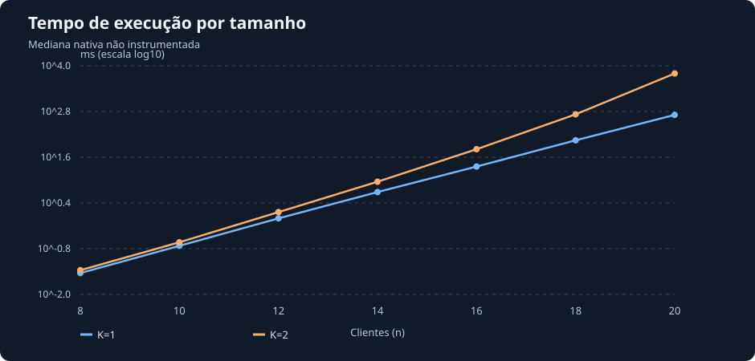
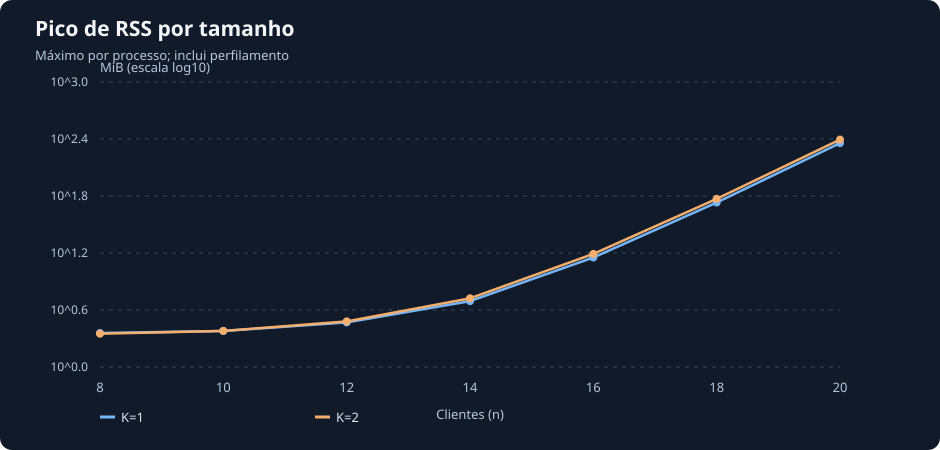
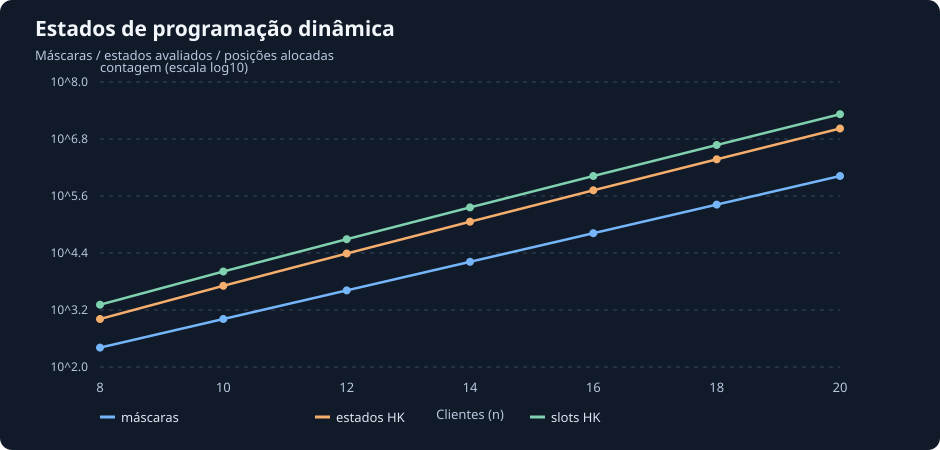

# Parte F — Experimentos computacionais

## 1. Objetivo e protocolo

O experimento mede o comportamento do resolvedor CVRP exato em Rust,
comparando as contagens observadas com a análise teórica da [Parte E](./complexidade.md).
Executado em 26/11/2026, 00:16 UTC, Ubuntu 24.04, x86_64, CPU: Intel(R) Xeon(R) 6975P-C, 4 CPUs lógicas; compilador rustc 1.100.0 (0ef1bc386 2026-11-09).
Foram considerados n em (8, 10, 12, 14, 16, 18, 20), nas séries K=1 e K=2, com semente 7, Q=n, L=1.000.000 e demanda unitária.
Uma matriz dirigida determinística fornece distâncias inteiras positivas de 1 a 29;
a fórmula e a semente encontram-se em src/bin/experiment.rs.
A capacidade e a distância não podam subconjuntos: é uma família deliberadamente densa,
útil para observar o pior crescimento combinatório, não uma simulação geográfica real.
Tempo: mediana do método solve() sem instrumentação, medido pelo Rust Instant;
3 repetições até n=14, 2 em n=16 e 1 em n=18/20.
Contadores: segunda passagem independente por solve_with_metrics(), excluída do tempo informado.
Memória: maior pico de RSS por processo isolado com /usr/bin/time -f %M,
incluindo preparação do problema e passagem instrumentada.
Cada repetição possui limite de 55 segundos: timeout é uma observação censurada e não um resultado ótimo.

## 2. Resultados

| Série | n | Subconjuntos 2^n | Estados HK | Candidatos partição | Tempo mediano (ms) | RSS (MiB) | Custo ótimo | Rotas | Atendidos | Status |
|---|---:|---:|---:|---:|---:|---:|---:|---:|---:|---|
| K=1 | 8 | 256 | 1.024 | 0 | 0.0363 | 2.28 | 44 | 1 | 8 | optimal |
| K=1 | 10 | 1.024 | 5.120 | 0 | 0.1886 | 2.39 | 48 | 1 | 10 | optimal |
| K=1 | 12 | 4.096 | 24.576 | 0 | 0.9904 | 2.95 | 55 | 1 | 12 | optimal |
| K=1 | 14 | 16.384 | 114.688 | 0 | 4.8452 | 4.94 | 62 | 1 | 14 | optimal |
| K=1 | 16 | 65.536 | 524.288 | 0 | 22.6800 | 14.21 | 56 | 1 | 16 | optimal |
| K=1 | 18 | 262.144 | 2.359.296 | 0 | 110.5175 | 53.96 | 64 | 1 | 18 | optimal |
| K=1 | 20 | 1.048.576 | 10.485.760 | 0 | 515.2887 | 227.29 | 62 | 1 | 20 | optimal |
| K=2 | 8 | 256 | 1.024 | 3.280 | 0.0433 | 2.24 | 44 | 1 | 8 | optimal |
| K=2 | 10 | 1.024 | 5.120 | 29.524 | 0.2334 | 2.40 | 48 | 1 | 10 | optimal |
| K=2 | 12 | 4.096 | 24.576 | 265.720 | 1.4479 | 3.02 | 55 | 1 | 12 | optimal |
| K=2 | 14 | 16.384 | 114.688 | 2.391.484 | 9.0774 | 5.29 | 62 | 1 | 14 | optimal |
| K=2 | 16 | 65.536 | 524.288 | 21.523.360 | 64.4943 | 15.52 | 56 | 1 | 16 | optimal |
| K=2 | 18 | 262.144 | 2.359.296 | 193.710.244 | 532.0461 | 59.00 | 64 | 1 | 18 | optimal |
| K=2 | 20 | 1.048.576 | 10.485.760 | 1.743.392.200 | 6269.4126 | 247.34 | 62 | 1 | 20 | optimal |

O [CSV com contadores e medições](./resultados-f/dados.csv) inclui repetições,
posições alocadas, transições Held–Karp e estados/candidatos da partição.

## 3. Gráficos

Os gráficos usam eixo vertical logarítmico. Séries interrompidas não recebem valores artificiais.

## 4. Discussão experimental e comparação com a Parte E

A primeira PD tem limite O(n² 2^n); a partição tem limite O(K 3^n).
A memória auxiliar cresce em O((n+K) 2^n).
Para a família escolhida, o programa confere em cada execução concluída:

- máscaras = 2^n;
- estados Held–Karp avaliados = n × 2^(n−1);
- transições Held–Karp = n(n−1) × 2^(n−2);
- candidatos da partição = (K−1)(3^n−1)/2, para K=1 ou K=2.

Portanto, a contagem observada dos estados e transições é exatamente compatível
com a análise combinatória nas instâncias sem podas.
Tempos e RSS fornecem evidências empíricas de crescimento, mas não demonstram
por si só a complexidade assintótica, pois sofrem influência de cache, CPU,
alocação, número de repetições e ruído do executor compartilhado.
Na série K=1, o tempo observado passou de 0.0363 ms (n=8) para 515.2887 ms (n=20), aproximadamente 14195.3 vezes.
Em K=2, o maior n concluído foi 20, com 1.743.392.200 candidatos enumerados.

## 5. Limitações e conclusão

Os custos são artificiais e as duas séries usam apenas K=1 ou K=2.
Não é correto extrapolar os tempos diretamente para operações reais com pedidos variáveis,
janelas de tempo ou demandas estocásticas.
Os resultados mostram o crescimento de estados 2^n e candidatos 3^n no modelo exato,
e ajudam a caracterizar o limite prático das instâncias no ambiente medido.
Para reproduzir: executar cargo test --all-targets,
cargo build --release --bin experiment e python3 scripts/parte_f.py.
