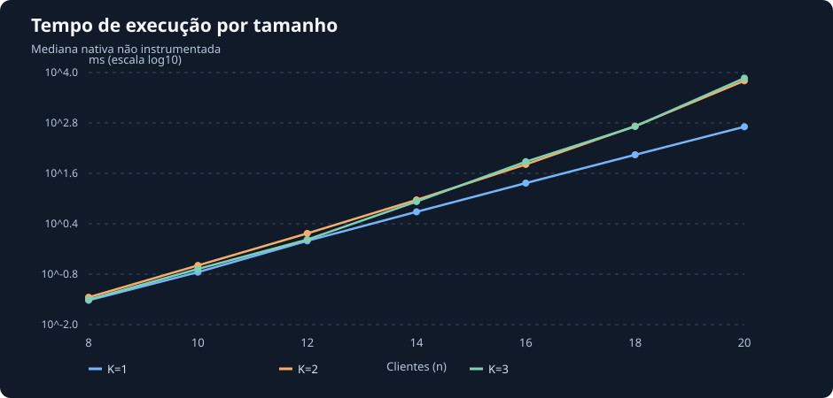
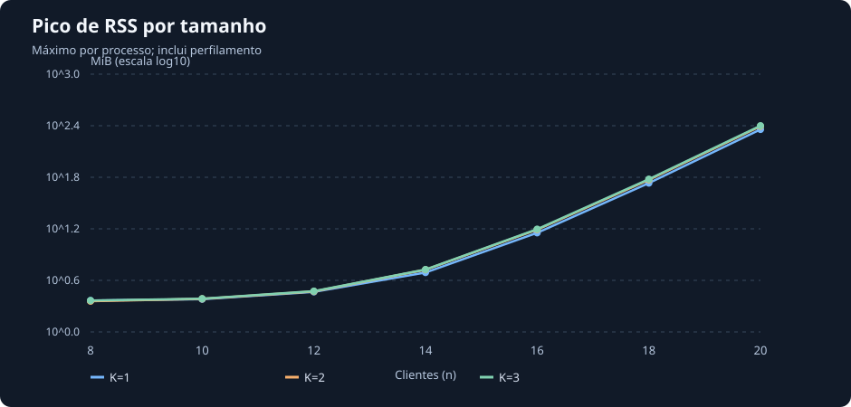
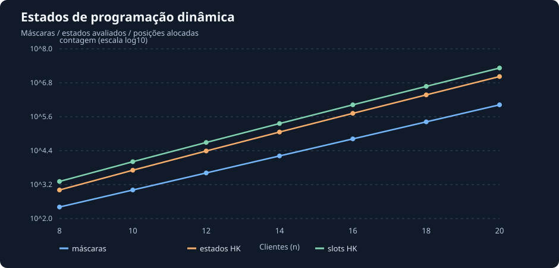
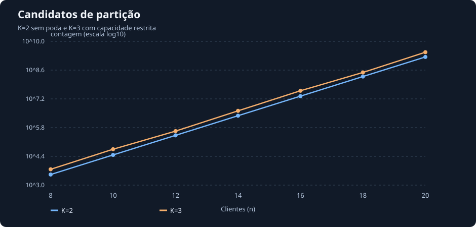

# Part F — Computational Experiments

## 1. Objective and experimental protocol

The experiments measure how the **exact Rust CVRP solver** behaves as the number of customers increases, comparing observed counts with the formal predictions of [Part E — Complexity](./complexity.md).

The source [Portuguese report](../ptBr/experimentos.md) records the original execution environment and timestamps. The measurements below reproduce **the same executions, numerical values, input instances, and computational protocol**, not a new benchmark.

- Runner: GitHub Actions, Ubuntu 24.04, x86_64, a shared four-logical-CPU runner, compiled with Rust release optimizations.
- Tested sizes: \(n\in\{8,10,12,14,16,18,20\}\).
- Three controlled series: \(K=1\), \(K=2\), and \(K=3\).
- Demand: 1 per customer; seed: 7; maximum completed route distance: \(L=1{,}000{,}000\).
- Directed distance matrix: deterministic integer costs from 1 to 29, defined by the modular formula in `src/bin/experiment.rs`.
- \(K=1\) and \(K=2\) use \(Q=n\), with no capacity pruning; \(K=3\) uses \(Q=\lceil n/3\rceil\), forcing three routes and triggering capacity pruning.
- Time: median elapsed time of **unprofiled** `solve()`, measured using Rust's `Instant`.
- Repetitions: three per case for \(n\le14\), two at \(n=16\), and one at \(n=18\) and \(n=20\).
- Counters: measured in a separate `solve_with_metrics()` pass whose duration is **excluded** from the reported solver time.
- Memory: maximum resident set size (RSS) measured with `/usr/bin/time -f %M`, including setup and the profiling pass; this is **not** solely the size of DP tables.
- Time limit: 55 seconds per process. An expired run would be reported as censored (timeout), never as a completed optimum.
- The data are **synthetic** and deliberately designed to expose combinatorial effects, not realistic geographic travel times.

## 2. Measured results

| Series | Customers n | Capacity Q | Subsets 2^n | Evaluated HK states | Partition candidates | Median time (ms) | Peak RSS (MiB) | Optimal cost | Routes | Customers served | Status |
|---|---:|---:|---:|---:|---:|---:|---:|---:|---:|---:|---| 
| K=1 | 8 | 8 | 256 | 1,024 | 0 | 0.0379 | 2.32 | 44 | 1 | 8 | optimal |
| K=1 | 10 | 10 | 1,024 | 5,120 | 0 | 0.1769 | 2.41 | 48 | 1 | 10 | optimal |
| K=1 | 12 | 12 | 4,096 | 24,576 | 0 | 0.9870 | 2.93 | 55 | 1 | 12 | optimal |
| K=1 | 14 | 14 | 16,384 | 114,688 | 0 | 4.8366 | 4.91 | 62 | 1 | 14 | optimal |
| K=1 | 16 | 16 | 65,536 | 524,288 | 0 | 23.3972 | 14.25 | 56 | 1 | 16 | optimal |
| K=1 | 18 | 18 | 262,144 | 2,359,296 | 0 | 110.1407 | 54.00 | 64 | 1 | 18 | optimal |
| K=1 | 20 | 20 | 1,048,576 | 10,485,760 | 0 | 512.3089 | 227.27 | 62 | 1 | 20 | optimal |
| K=2 | 8 | 8 | 256 | 1,024 | 3,280 | 0.0448 | 2.28 | 44 | 1 | 8 | optimal |
| K=2 | 10 | 10 | 1,024 | 5,120 | 29,524 | 0.2556 | 2.43 | 48 | 1 | 10 | optimal |
| K=2 | 12 | 12 | 4,096 | 24,576 | 265,720 | 1.4810 | 2.96 | 55 | 1 | 12 | optimal |
| K=2 | 14 | 14 | 16,384 | 114,688 | 2,391,484 | 9.3163 | 5.30 | 62 | 1 | 14 | optimal |
| K=2 | 16 | 16 | 65,536 | 524,288 | 21,523,360 | 64.9014 | 15.50 | 56 | 1 | 16 | optimal |
| K=2 | 18 | 18 | 262,144 | 2,359,296 | 193,710,244 | 529.3807 | 59.02 | 64 | 1 | 18 | optimal |
| K=2 | 20 | 20 | 1,048,576 | 10,485,760 | 1,743,392,200 | 6383.2814 | 247.27 | 62 | 1 | 20 | optimal |
| K=3 | 8 | 3 | 256 | 232 | 5,920 | 0.0394 | 2.32 | 78 | 3 | 8 | optimal |
| K=3 | 10 | 4 | 1,024 | 1,300 | 55,976 | 0.2112 | 2.44 | 72 | 3 | 10 | optimal |
| K=3 | 12 | 4 | 4,096 | 2,784 | 426,992 | 1.0571 | 2.98 | 83 | 3 | 12 | optimal |
| K=3 | 14 | 5 | 16,384 | 15,302 | 4,158,328 | 8.4927 | 5.32 | 78 | 3 | 14 | optimal |
| K=3 | 16 | 6 | 65,536 | 79,104 | 39,475,008 | 75.6628 | 15.70 | 73 | 3 | 16 | optimal |
| K=3 | 18 | 6 | 262,144 | 169,236 | 307,564,872 | 519.6812 | 59.89 | 79 | 3 | 18 | optimal |
| K=3 | 20 | 7 | 1,048,576 | 875,920 | 2,968,624,016 | 7370.9727 | 251.02 | 79 | 3 | 20 | optimal |

The [machine-readable CSV](./results/data.csv) includes Held–Karp transitions, allocated slots, partition states, repetitions and measured elapsed time and RSS in their original units.

**All 21 cases completed with an optimal solution.** Every instance served all customers. The third series used exactly three routes throughout, while the other two series could use one route because the capacity permitted it.

## 3. Experimental plots









All plots use a logarithmic vertical scale, so changes across orders of magnitude remain visible. Missing measurements, if any, are omitted rather than interpolated.

## 4. Experimental discussion versus Part E

The theoretical bounds are

\[
T(n,K)=O(n^2 2^n+K3^n),\qquad
M(n,K)=O((n+K)2^n).
\]

In the dense \(K=1\) and \(K=2\) series without pruning, the following mathematical counts were verified by the instrumented solver:

\[
\text{subsets}=2^n,\qquad
\text{Held--Karp states}=n2^{n-1},
\]

\[
\text{Held--Karp transitions}=n(n-1)2^{n-2},
\]

\[
\text{partition candidates}=(K-1)(3^n-1)/2
\quad(K=1,2).
\]

These are exact counts for the chosen no-pruning instance family. For \(K=3\), they are **upper bounds**, and the measured counters show the effect of capacity pruning.

At \(n=20\):

- \(K=1\) examined 10,485,760 Held–Karp states and no additional partition candidates; the optimum used one route of cost 62.
- \(K=2\) examined the same Held–Karp states plus 1,743,392,200 partition candidates, while the optimum still used one route of cost 62.
- \(K=3,Q=7\) examined **875,920** Held–Karp states due to capacity pruning, yet enumerated **2,968,624,016** partition candidates. The optimum required three routes of total cost 79.

The series illustrate that pruning the Held–Karp stage does **not** necessarily make the complete algorithm faster; partition enumeration can dominate. Measured execution times and RSS are compatible with exponential growth, but cannot in themselves prove asymptotic complexity because hardware, memory hierarchy, scheduling and sample size influence timings.

## 5. Limitations, reproducibility, and conclusion

These results are valid for the stated deterministic, synthetic input family and benchmark environment. They must not be extrapolated directly to real food delivery, random demands, order arrival dynamics, or time windows.

To reproduce on Linux with Rust, Python 3, and `/usr/bin/time`:

```bash
cargo test --all-targets
cargo build --release --bin experiment
python3 scripts/parte_f.py --timeout 55 --seed 7
```

The complete experiment code, collected counts, source CSV and SVG plots are available in the [repository](https://github.com/jhserodio/logistic_problem_with_max_capacity). No computed results are invented for timed-out runs.

**Conclusion:** the observations support Part E's prediction that subset states scale as \(2^n\), while fleet partitioning may grow as \(3^n\). The exact method is valuable as a reference solver for small and moderately sized instances; larger stochastic logistics scenarios require different scalable approaches.
