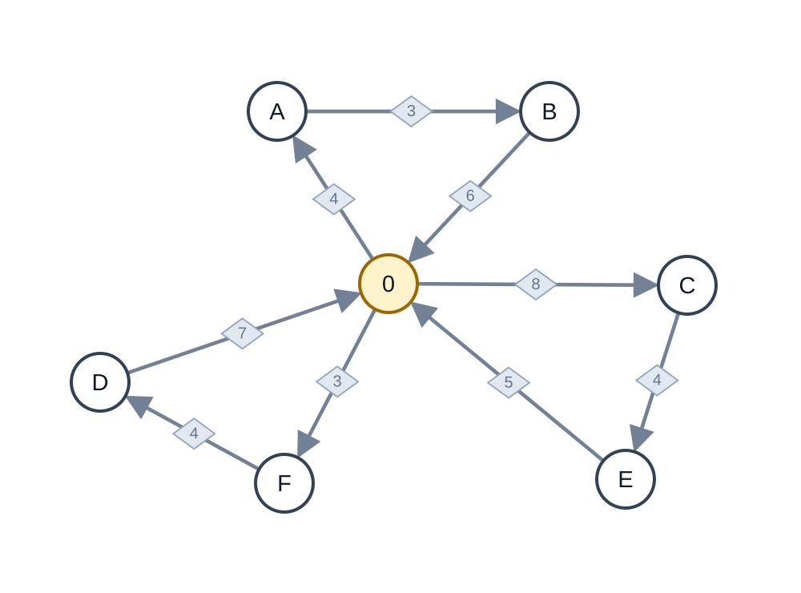
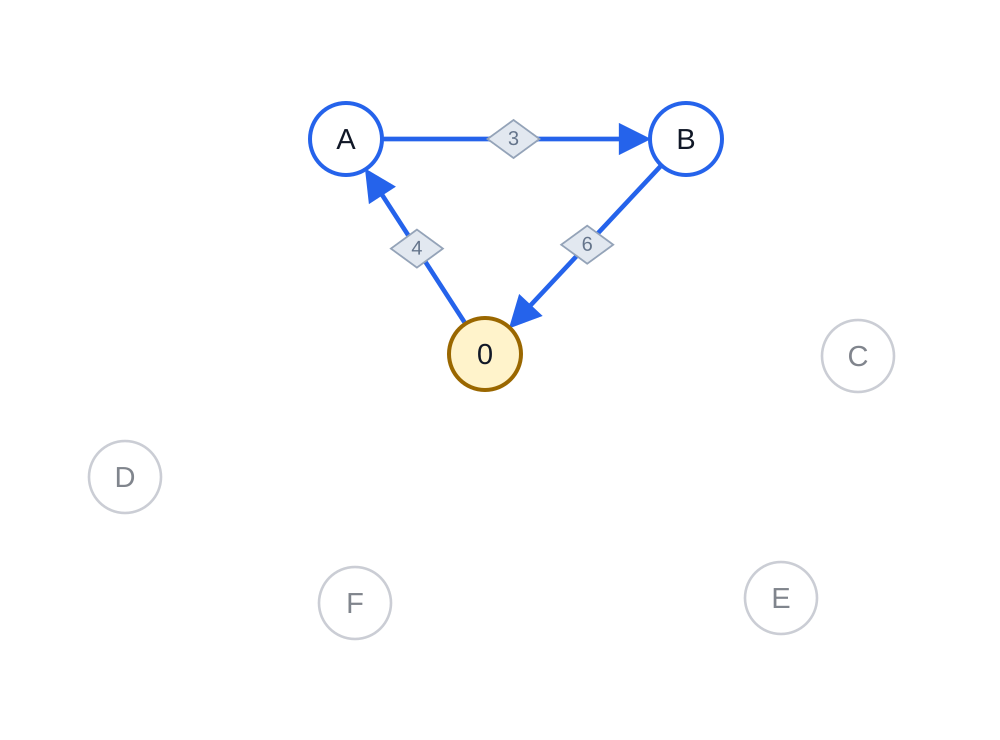
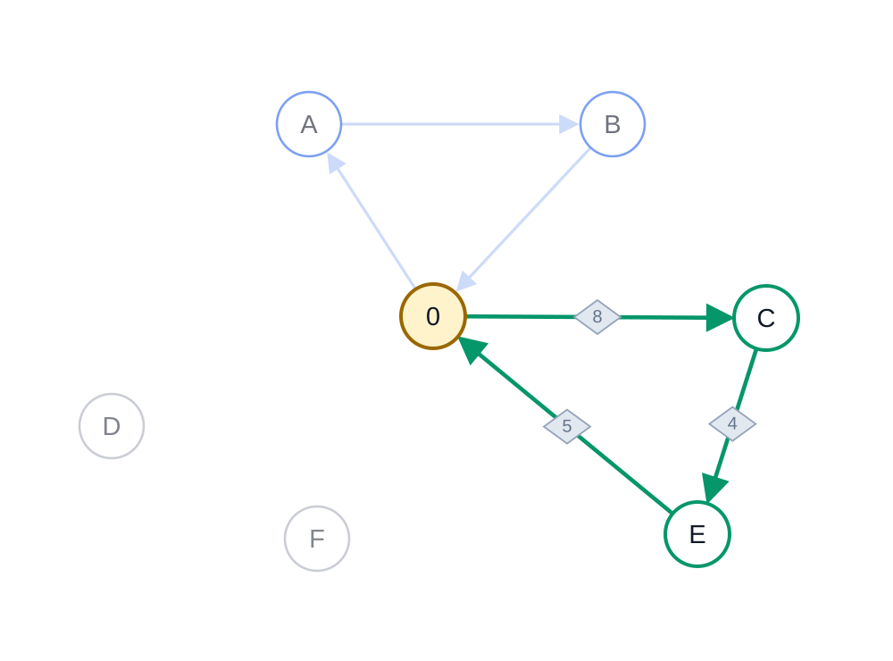
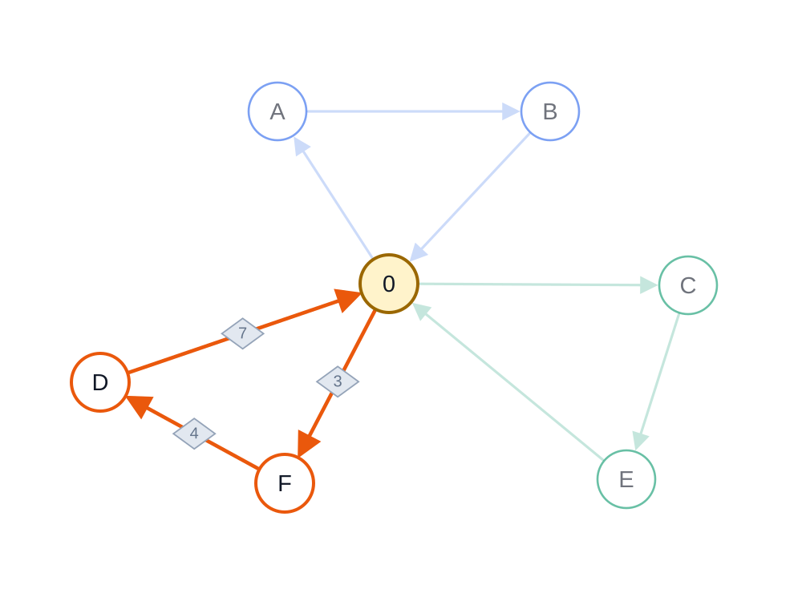
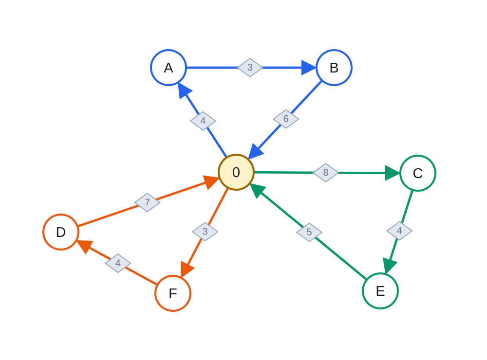

# Graph Analysis — Deterministic CVRP

This document complements [Part A — MILP modeling](./milp-model.md), [Part B — Dynamic Programming](./dynamic-programming.md) and [Part C — Maximum route distance](./extension.md). Its purpose is to show **the instance, a step-by-step hand calculation, and the gradual route visualization**. The example is deterministic and **illustrates a feasible solution, not by itself a proven global optimum**.

## 1. Directed graph of the problem

**Figure 1 — Illustrative graph.** Vertex 0 is the depot. Customers A, B, C, D, E and F correspond to mathematical indices 1 through 6. Arrowheads indicate travel direction; light-gray diamonds label arc weights. The SVG has a transparent background.

### Legend and definitions

- **Vertices:** A–F inside circles are customers; the gold circle labeled 0 is the depot.
- **Arcs:** directed arrows. The number inside each light-gray diamond is that arc's distance.
- **Topology:** vertex placement is illustrative; drawing coordinates do not determine travel distances.

**Customer set:**

\[
C=\{1,2,3,4,5,6\}.
\]

**Vertices and directed arcs of the full mathematical model:**

\[
V=\{0\}\cup C,\qquad
A=\{(i,j)\in V\times V:i\ne j\}.
\]

**Nonnegative distances:**

\[
c_{ij}\ge0.
\]

**Note:** only nine arcs from the hand-calculated solution are shown. The Part A MILP and Part B DP admit all arcs between distinct vertices, so the full instance also needs distances for the remaining arcs. The illustration alone is not sufficient to prove global optimality.

### Example parameters

| Parameter | Value | Meaning |
|---|---:|---|
| Q | 7 | Maximum capacity per vehicle |
| K | 3 | Maximum number of vehicles (one route each) |
| L | 18 | Maximum distance per completed route |

**Visual labels mapped to mathematical indices:**

| SVG label | A | B | C | D | E | F |
|---|---:|---:|---:|---:|---:|---:|
| Model index | 1 | 2 | 3 | 4 | 5 | 6 |
| Demand | 2 | 4 | 3 | 4 | 2 | 3 |

The mathematical indices are used consistently in Parts A–C, the hand calculation and the equations.

**Arc weights used in the figures:**

| Route | Arcs and respective distances |
|---|---|
| Blue | 0 → 1: **4**; 1 → 2: **3**; 2 → 0: **6** |
| Green | 0 → 3: **8**; 3 → 5: **4**; 5 → 0: **5** |
| Orange | 0 → 6: **3**; 6 → 4: **4**; 4 → 0: **7** |

## 2. Hand calculation — constructing a candidate solution

We choose three disjoint customer subsets and construct a candidate route for each vehicle. This demonstrates **how to check a solution**, not how the exact optimizer explores all possible choices.

**Candidate customer partition:**

\[
T_1=\{1,2\},\qquad T_2=\{3,5\},\qquad T_3=\{6,4\}.
\]

At each step, we add the next arc's travel distance and, when the destination is not the depot, the receiving customer's demand. The *demand served so far* column sums demands of customers already visited **on that route**. It does **not** mean physical remaining load. On returning to the depot, cumulative served demand remains the total for that route.

| Route | Step | Arc | Arc distance | Demand delivered | Demand served on route | Cumulative distance |
|---|---:|---|---:|---:|---:|---:|
| 1 — blue | 1 | 0 → 1 | 4 | 2 | 2 | 4 |
| 1 — blue | 2 | 1 → 2 | 3 | 4 | 6 | 7 |
| 1 — blue | 3 | 2 → 0 | 6 | 0 | **6** | **13** |
| 2 — green | 1 | 0 → 3 | 8 | 3 | 3 | 8 |
| 2 — green | 2 | 3 → 5 | 4 | 2 | 5 | 12 |
| 2 — green | 3 | 5 → 0 | 5 | 0 | **5** | **17** |
| 3 — orange | 1 | 0 → 6 | 3 | 3 | 3 | 3 |
| 3 — orange | 2 | 6 → 4 | 4 | 4 | 7 | 7 |
| 3 — orange | 3 | 4 → 0 | 7 | 0 | **7** | **14** |

### Constraint checks

| Route | Customers | Total demand | Completed distance | Capacity ≤ 7 | Distance ≤ 18 |
|---|---|---:|---:|---|---|
| 1 — blue | 1, 2 | 6 | 13 | Yes | Yes |
| 2 — green | 3, 5 | 5 | 17 | Yes | Yes |
| 3 — orange | 6, 4 | 7 | 14 | Yes | Yes |

**Complete customer coverage:** all six customers appear exactly once across the three disjoint subsets.

**Vehicles used:**

\[
m=3\le K=3.
\]

**Candidate solution total distance:**

\[
Z_{\mathrm{candidate}}=13+17+14=44.
\]

This hand calculation establishes **feasibility** for the displayed arcs. To prove a global optimum, the missing arc distances must be supplied and the exact algorithm executed. The repository's full **synthetic test matrix** fills those other arcs with cost 100 and does indeed yield an optimal cost of 44; this additional fact is not inferred from the partial figure.

## 3. Step-by-step graph visualization

The following figures preserve **identical vertex coordinates**. Each step emphasizes a newly added route while fading previously constructed routes. The final figure displays them simultaneously.

### Step 1 — Build the blue route

**Figure 2 — First route.** \(0\to A\to B\to0\) (indices \(0\to1\to2\to0\)). Served demand: **6**. Total distance: **13**. Both limits are satisfied.

### Step 2 — Add the green route

**Figure 3 — Second route.** \(0\to C\to E\to0\) (indices \(0\to3\to5\to0\)). Served demand: **5**. Total distance: **17**. The blue and green routes serve disjoint customers.

### Step 3 — Add the orange route

**Figure 4 — Third route.** \(0\to F\to D\to0\) (indices \(0\to6\to4\to0\)). Served demand: **7**. Total distance: **14**. Every customer is covered, and all three available vehicles are used.

### Final view — All routes

**Figure 5 — Illustrated feasible solution.** All routes start and end at the same depot, serve distinct customers, and have combined travel distance **44**. Blue, green and orange are purely route identifiers.

## 4. Connection to the proposed dynamic programming algorithm

The **hand calculation** checks one candidate partition. Part B performs an **exact search** over routes and partitions rather than assuming the candidate is best.

**Stage 1 — Held–Karp finds the best visit order for each subset:**

\[
H(\{j\},j)=c_{0j},
\]

\[
H(T,j)=\min_{i\in T\setminus\{j\}}
\left(H(T\setminus\{j\},i)+c_{ij}\right).
\]

**Closed route cost (including depot return):**

\[
D(T)=\min_{j\in T}\left(H(T,j)+c_{j0}\right).
\]

**Subset demand and feasibility:**

\[
A(T)=\sum_{i\in T}d_i,\qquad A(T)\le Q,\qquad D(T)\le L.
\]

**Stage 2 — Partition customers into at most \(K\) feasible routes:**

\[
r_{Q,L}(T)=
\begin{cases}
D(T),&A(T)\le Q\ \text{and}\ D(T)\le L,\\
+\infty,&\text{otherwise},
\end{cases}
\]

\[
G(S,k)=\min_{\substack{T\subseteq S,\ a(S)\in T\\r_{Q,L}(T)<+\infty}}
\left(r_{Q,L}(T)+G(S\setminus T,k-1)\right).
\]

**Boundary conditions and global optimum:**

\[
G(\varnothing,k)=0,\qquad G(S,0)=+\infty\quad(S\ne\varnothing),
\qquad Z^*=G(C,K).
\]

The visualization depicts **one possible choice of subsets**. The recurrence determines the minimum cost among all admissible choices once the complete distance matrix is defined.

## 5. Limitations and next steps

- **Didactic instance:** vertex positions are designed for presentation, not geographical coordinates.
- **Partially drawn graph:** only nine arc weights are shown. This is sufficient to evaluate the three illustrated routes but not to compare all possible CVRP solutions.
- **Deterministic model:** vehicle capacity, demand and distances are known; a future stochastic model requires independent modeling.
- **Optimality distinction:** these hand calculations and SVGs establish feasibility only. The separate complete test matrix and Rust solver support the reported optimum of 44.
